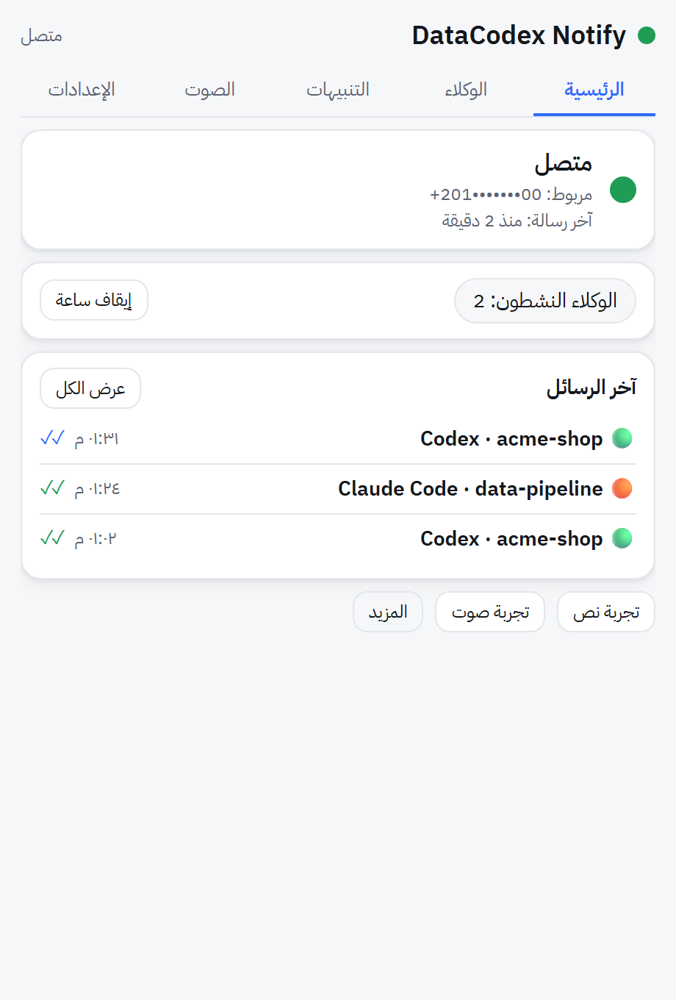
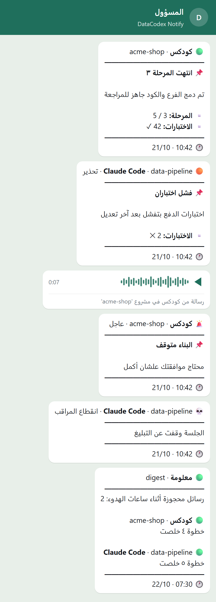
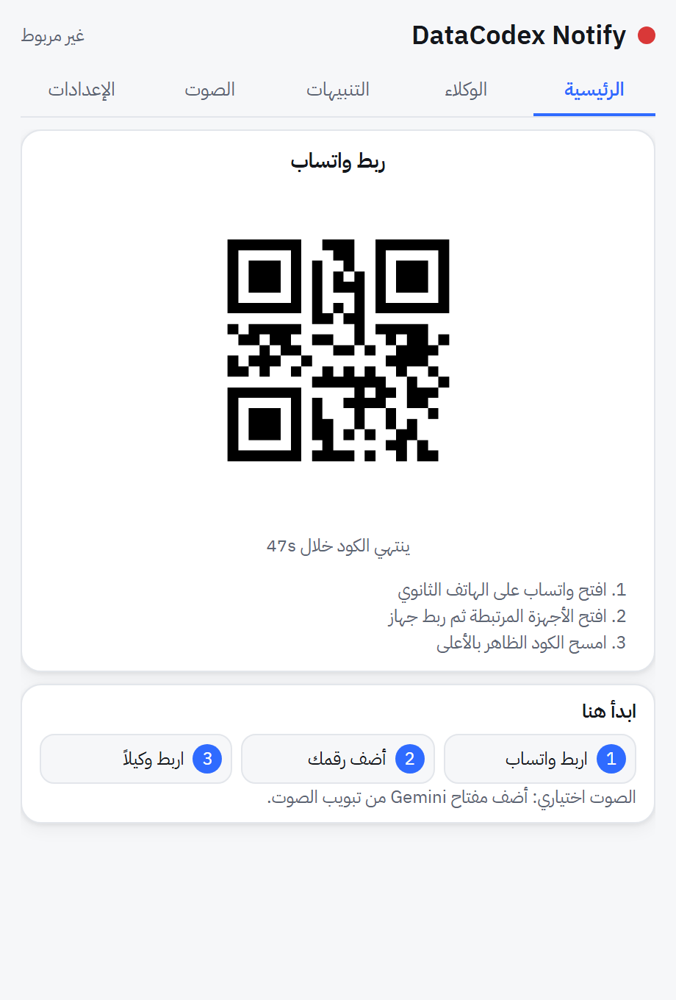
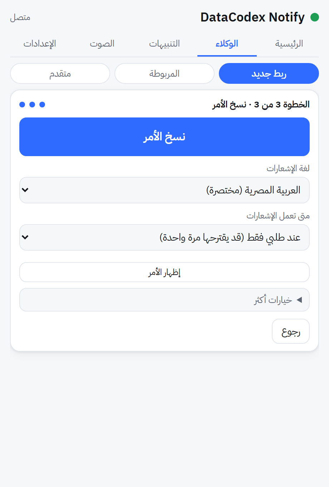
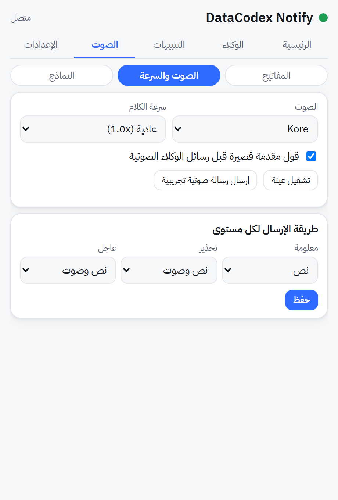
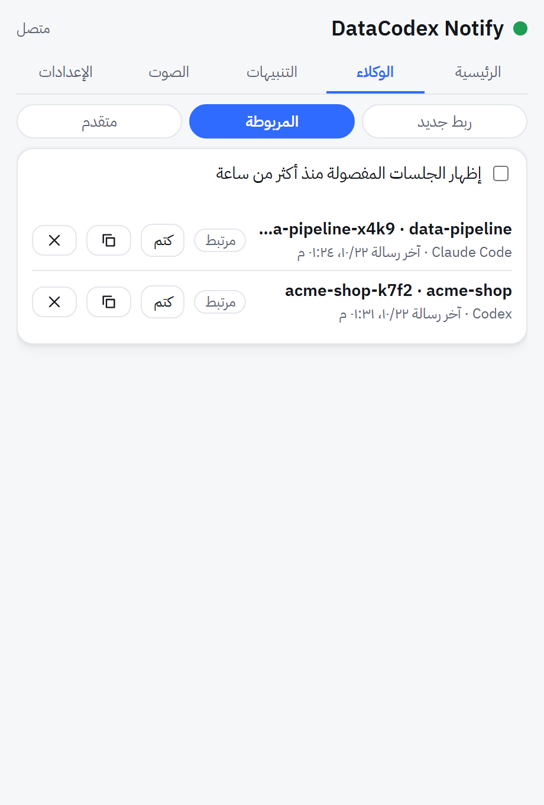
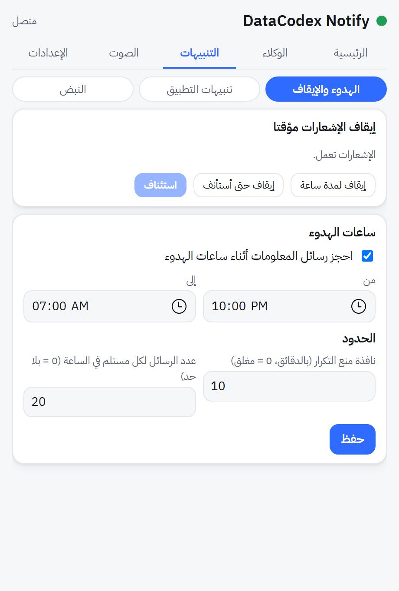
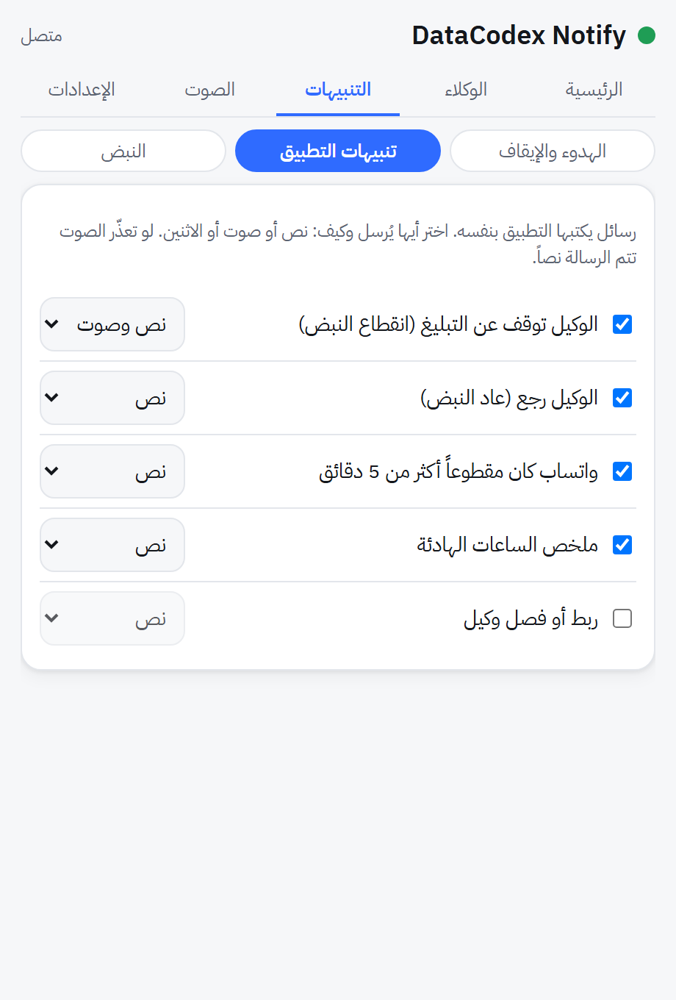
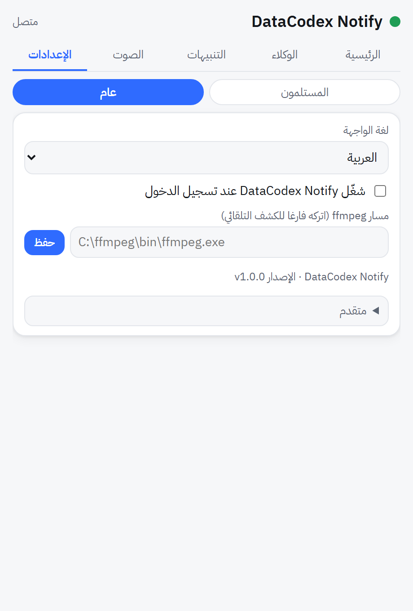
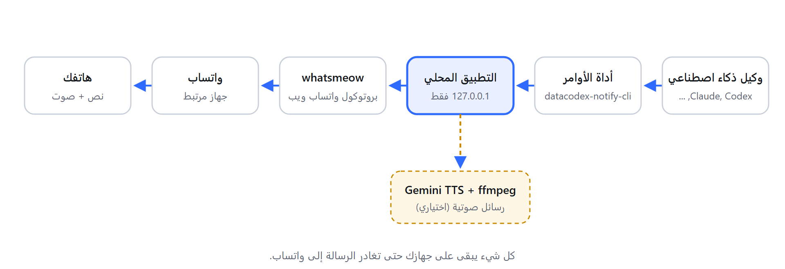

<div align="center" dir="rtl">

# DataCodex Notify

**وكيل الذكاء الاصطناعي يراسلك على واتساب عندما يحتاجك.**
رسائل نصية وصوتية من Claude Code أو Codex أو Gemini، من تطبيق صغير في شريط مهام ويندوز يعمل بالكامل على جهازك.

[](LICENSE)
[](https://github.com/datacodexlab/datacodex-notify/releases)
[](https://github.com/datacodexlab/datacodex-notify/actions/workflows/ci.yml)
[](#المتطلبات)

[العرض التقديمي](https://datacodexlab.github.io/datacodex-notify/?lang=ar) | [English](README.md)

 &nbsp; 

</div>

<div dir="rtl">

---

## لماذا

التشغيل الطويل للوكلاء لا يناسب الجلوس أمام الشاشة. يفشل البناء في الدقيقة الثانية عشرة، ثم ينتظر الوكيل موافقتك ساعتين، وتعرف وقت العشاء. DataCodex Notify يحوّل هذه الجلسات إلى رسائل واتساب قصيرة (ورسالة صوتية عندما يستحق الأمر)، فتستطيع أن تبتعد عن الجهاز.

## المزايا

- **رسائل واتساب نصية وصوتية** من أي وكيل عبر أداة أوامر صغيرة واحدة.
- **تنسيق واضح للرسالة:** الوكيل والمشروع في العنوان، وعنوان اختياري، وحقائق قصيرة (مفتاح وقيمة)، والوقت. رسائل التحذير والعاجل تبرز بوضوح.
- **رسائل صوتية بصوت Gemini:** بمفتاحك الخاص، ونماذج قابلة للاختيار مع نموذج احتياطي، وسرعة عادية أو سريعة أو سريعة جدًا، ومقدمة منطوقة اختيارية. إذا تعذر الصوت تُرسل الرسالة نصًا ولا تضيع.
- **ربط وكيل في ثلاث خطوات:** يكتب التطبيق أمرًا تلصقه في الوكيل، فيكتب الوكيل تعليماته في ملفه. ويمكن تثبيت مهارة (skill) لـ Claude Code وCodex من النافذة.
- **قواعد:** ساعات هدوء مع ملخص واحد بعدها، وإيقاف مؤقت لساعة، ومنع التكرار، وحد للرسائل في الساعة، وكتم وكيل واحد أو الجميع.
- **نبض المراقبة (heartbeat):** إذا توقف الوكيل عن التبليغ تصلك رسالة بدل الصمت.
- **تحكم في كل تنبيه:** لكل رسالة يكتبها التطبيق بنفسه مفتاح تشغيل وطريقة (نص أو صوت أو الاثنان).
- **محلي أولًا:** الواجهة البرمجية تسمع على `127.0.0.1` فقط، والمفاتيح في Windows Credential Manager.
- **واجهة بالعربية والإنجليزية** تدعم الاتجاه من اليمين لليسار.

## لقطات الشاشة

كل اللقطات ببيانات تجريبية ومولّدة من الكود (انظر [المساهمة](#المساهمة)).

| ربط واتساب | الرئيسية | ربط وكيل | الصوت |
|---|---|---|---|
|  |  |  |  |

| الوكلاء | التنبيهات | تنبيهات التطبيق | الإعدادات |
|---|---|---|---|
|  |  |  |  |

## كيف يعمل



1. يشغّل الوكيل `datacodex-notify-cli send ...`.
2. تتصل الأداة بالتطبيق المحلي على `127.0.0.1` برمز وصول تقرؤه من Windows Credential Manager.
3. يطبّق التطبيق قواعدك وينسّق الرسالة ويرسلها عبر جهاز مرتبط ([whatsmeow](https://github.com/tulir/whatsmeow)).
4. للصوت: يطلب التطبيق الكلام من Gemini ويحوّله بـ ffmpeg.

## المتطلبات

- ويندوز 10 أو 11 (64 بت).
- متصفح Microsoft Edge (لنافذة الإعدادات).
- رقم **ثانوي** عليه واتساب للربط (انظر [إخلاء المسؤولية](#إخلاء-المسؤولية)).
- اختياري للصوت: برنامج [ffmpeg](https://ffmpeg.org/) ومفتاح Gemini.
- للبناء من المصدر: Go 1.26 أو أحدث. إصدارات الإنتاج بلغة Go فقط (`CGO_ENABLED=0`).

## التثبيت

**المثبّت (الموصى به).** نزّل `DatacodexNotify-Setup-<version>.exe` من صفحة [Releases](https://github.com/datacodexlab/datacodex-notify/releases) وشغّله. يثبّت لمستخدمك فقط (دون صلاحيات المدير) في `%LOCALAPPDATA%\Programs\DatacodexNotify\`، ويضيف اختصارًا في قائمة ابدأ، ويعرض خيارين: *التشغيل مع ويندوز* و*تثبيت مهارة الوكيل*. التثبيت فوق إصدار أقدم يحافظ على بياناتك. المزيل يوقف التطبيق ويسأل قبل حذف بياناتك (ربط واتساب وسجل الرسائل).

**النسخة المحمولة.** `DatacodexNotify-Portable-<version>.zip` فيها البرنامجان بدون مثبّت، وبداخلها `README-portable.txt`.

**ملفات غير موقّعة وSmartScreen.** الإصدارات غير موقّعة رقميًا حتى الآن، فقد تظهر رسالة "Windows protected your PC". اضغط **More info** ثم **Run anyway**. قبل ذلك قارن الملف بـ `SHA256SUMS` من صفحة الإصدار نفسها:

```powershell
Get-FileHash .\DatacodexNotify-Setup-<version>.exe -Algorithm SHA256
```

لبناء المثبّت بنفسك تحتاج [Inno Setup](https://jrsoftware.org/isinfo.php) (`winget install JRSoftware.InnoSetup`): شغّل `./installer/build.ps1 -Version <version>` وستظهر الملفات في `dist/`.

**سطر الأوامر فقط.** `datacodex-notify-cli skill install` يثبّت مهارة الوكيل لـ Claude Code وCodex بدون النافذة (و`skill remove` يزيلها).

من المصدر:

```powershell
git clone https://github.com/datacodexlab/datacodex-notify.git
cd datacodex-notify
$env:CGO_ENABLED = "0"
go build -trimpath -ldflags "-s -w -H=windowsgui -X main.version=1.0.0" -o dist/datacodex-notify.exe ./cmd/datacodex-notify
go build -trimpath -ldflags "-s -w -X main.version=1.0.0" -o dist/datacodex-notify-cli.exe ./cmd/datacodex-notify-cli
```

يستخدم التطبيق المنفذ `48700` (وينتقل إلى `48701`-`48709` إذا كان مشغولًا) ويحفظ بياناته في `%LOCALAPPDATA%\DatacodexNotify\`.

## ربط واتساب

1. شغّل التطبيق وافتح النافذة من أيقونة الشريط.
2. على الهاتف الثانوي: واتساب ثم **الأجهزة المرتبطة** ثم **ربط جهاز**، وامسح الكود في الشاشة الرئيسية.
3. إذا انتهت صلاحية الكود اضغط **اعرض كود جديد**.
4. أضف الرقم الذي سيستلم الرسائل (الإعدادات ثم المستلمون).

## ربط وكيل

1. افتح **الوكلاء ثم ربط جديد**.
2. اختر الوكيل ومكان كتابة القواعد، واختر مقدار التبليغ (هادئ أو عادي أو مفصّل)، واضغط **نسخ الأمر**.
3. الصق الأمر في الوكيل. سيكتب كتلة قصيرة في ملف قواعده. الأمر لا يحتوي أبدًا على كلمة مرور أو رمز.
4. اختياري: **الوكلاء ثم متقدم ثم تثبيت أو تحديث** لتثبيت المهارة في Claude Code وCodex.

تبقى التنبيهات مغلقة حتى تفعّلها في محادثة الوكيل (مثل "notify on"). طلب لمرة واحدة مثل "ابعتلي رسالة تجربة" يرسل رسالة واحدة دون تسجيل جلسة.

## مرجع سطر الأوامر

```text
datacodex-notify-cli send --level info|warning|critical --text-file message.txt
    [--title TEXT] [--field key=value ...] [--project NAME] [--source claude-code|codex|gemini|other]
    [--session NAME] [--mode text|voice|both] [--speech-file speech.txt] [--to NAME|NUMBER]
    [--dedupe-key KEY] [--wait SECONDS]
datacodex-notify-cli connect --source ... --session NAME [--project NAME] [--rules-file PATH ...]
datacodex-notify-cli disconnect --session NAME
datacodex-notify-cli heartbeat --id ID [--every SECONDS --grace SECONDS --label TEXT --session NAME]
datacodex-notify-cli heartbeat-stop --id ID
datacodex-notify-cli status | open | version
```

اكتب النص غير اللاتيني في ملف UTF-8 ومرّره بـ `--text-file`. الحدود: العنوان 120 حرفًا، وحتى 8 حقول (المفتاح 40 والقيمة 200 حرف)، والنص المنطوق 600 حرف، و`--wait` حتى 60 ثانية.

| رمز الخروج | المعنى |
|---|---|
| 0 | قُبلت (في الطابور أو أُرسلت أو محجوزة عمدًا) |
| 1 | خطأ في الخدمة، أو فشلت الرسالة أثناء الانتظار |
| 2 | التطبيق غير شغال |
| 3 | فشل التوثيق |
| 4 | طلب غير صالح (خيار خاطئ أو نص فارغ أو تجاوز الحدود) |
| 5 | مكررة أو تجاوزت الحد (ليس خطأ) |
| 6 | كتم المستخدم هذه الجلسة أو كل الوكلاء: توقف عن الإرسال |
| 7 | مع `--wait`: ما زالت في الطابور بعد الانتظار (ليس خطأ) |

## الخصوصية والأمان

- الواجهة البرمجية تسمع على `127.0.0.1` وترفض الطلبات ذات `Host` غريب أو ترويسة `Origin`.
- واجهة الوكلاء تستخدم رمز Bearer، والنافذة تستخدم كوكي جلسة HTTP-only مع رمز CSRF. يُنشأ الرمز عند أول تشغيل ويُحفظ في Windows Credential Manager، ويمكن تدويره من **الوكلاء ثم متقدم**.
- مفاتيح Gemini تُحفظ في Credential Manager وتظهر مخفية ولا تُكتب في السجلات ولا في الأوامر المولّدة.
- نص الرسالة يُرسل إلى واتساب فقط (وللرسائل الصوتية يُرسل النص المنطوق إلى Gemini من Google). لا يخرج شيء آخر من جهازك.
- سجل الرسائل في ملف SQLite محلي داخل `%LOCALAPPDATA%\DatacodexNotify\`.

## إخلاء المسؤولية

DataCodex Notify **غير مرتبط بواتساب أو Meta ولا معتمد منهما**. يستخدم مكتبة [whatsmeow](https://github.com/tulir/whatsmeow) المفتوحة المصدر، وهي عميل **غير رسمي** لبروتوكول واتساب ويب. قد يقيّد واتساب الحسابات التي تستخدم عملاء غير رسميين أو يحظرها، وقد يتغير البروتوكول في أي وقت. **استخدم رقمًا ثانويًا تتحمل فقدانه**، وأبقِ حجم الرسائل منخفضًا، واستخدمه على مسؤوليتك. "WhatsApp" علامة تجارية لصاحبها وتُذكر هنا لوصف التوافق فقط.

## أسئلة شائعة

**هل يعمل على macOS أو Linux؟** ليس بعد. شريط المهام وتخزين Credential Manager ومشغّل النافذة خاصة بويندوز.

**هل أحتاج إلى مزايا الصوت؟** لا. بدون مفتاح Gemini أو ffmpeg تُرسل كل الرسائل نصًا.

**هل يمكن لعدة وكلاء استخدامه؟** نعم. كل محادثة تسجل جلستها، وتستطيع رؤيتها وكتمها وحذفها من **الوكلاء ثم المرتبطة**.

**ماذا لو قال واتساب إن التطبيق قديم؟** تظهر لافتة في النافذة وتصبح أيقونة الشريط حمراء. حدّث التطبيق (مكتبة واتساب تحتاج إصدارًا أحدث).

**أين بياناتي؟** في `%LOCALAPPDATA%\DatacodexNotify\` (الإعدادات والسجل وجلسة واتساب). الإزالة تعني حذف مجلد البرنامج ومجلد البيانات.

## المساهمة

المساهمات مرحّب بها. أبقِ التغييرات صغيرة ومختبرة.

```powershell
go vet ./...
go test -short ./...                 # الحزمة السريعة
go test -tags devfake ./...          # مرسل واتساب وهمي دون شبكة
go test ./internal/ui                # يرسم كل التبويبات في Edge (يحتاج Node وEdge)
```

أعد توليد اللقطات ونماذج المحادثة والمخطط بعد أي تغيير في الواجهة أو تنسيق الرسائل. الأمر يرسم بيانات العرض من الكود عند HEAD (ويرفض العمل إذا كان في `web/` تغييرات غير مثبتة) ويكتب `docs/assets/BUILD-INFO.txt` بالـ commit المستخدم:

```powershell
go run ./tools/docsgen
```

يحتاج Go وNode وMicrosoft Edge. لا تُقرأ أي بيانات حقيقية: اللقطات من واجهة وهمية باسم ورقم ومشاريع مختلقة.

## الرخصة

DataCodex Notify برنامج حر: يمكنك إعادة توزيعه و/أو تعديله وفق شروط **رخصة جنو العمومية، الإصدار 3 فقط** (SPDX: `GPL-3.0-only`). انظر [LICENSE](LICENSE).

حقوق النشر (C) 2026 DataCodex

يُوزَّع هذا البرنامج على أمل أن يكون مفيدًا، لكن **بدون أي ضمان**، ولا حتى الضمان الضمني للرواج التجاري أو الملاءمة لغرض معين. راجع رخصة جنو العمومية لمزيد من التفاصيل.

لماذا GPL-3.0-only: مكتبات واتساب التي يعتمد عليها التطبيق تتضمن `go.mau.fi/libsignal` وهي مرخّصة بـ GPL-3.0 (الإصدار 3 دون خيار "أو أحدث")، لذلك يُوزَّع البرنامج المجمّع بهذه الرخصة. بقية المكتبات ورخصها في [THIRD_PARTY_NOTICES.md](THIRD_PARTY_NOTICES.md). الخط المرفق: IBM Plex Sans Arabic (رخصة SIL OFL، انظر `web/fonts/LICENSE-OFL.txt`).

</div>
