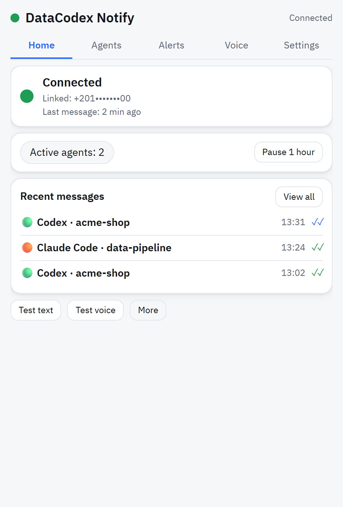
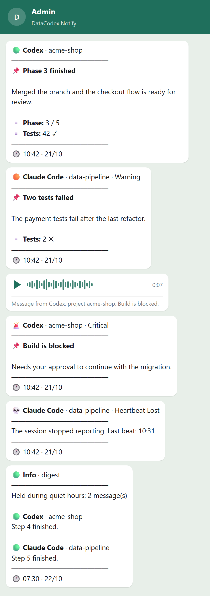
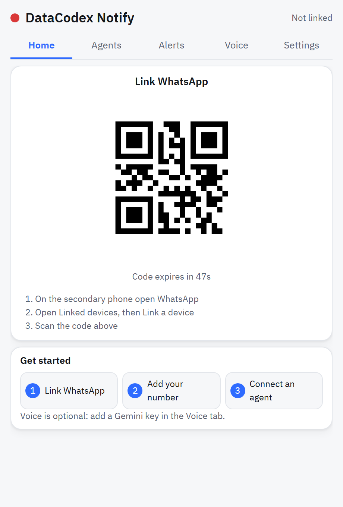
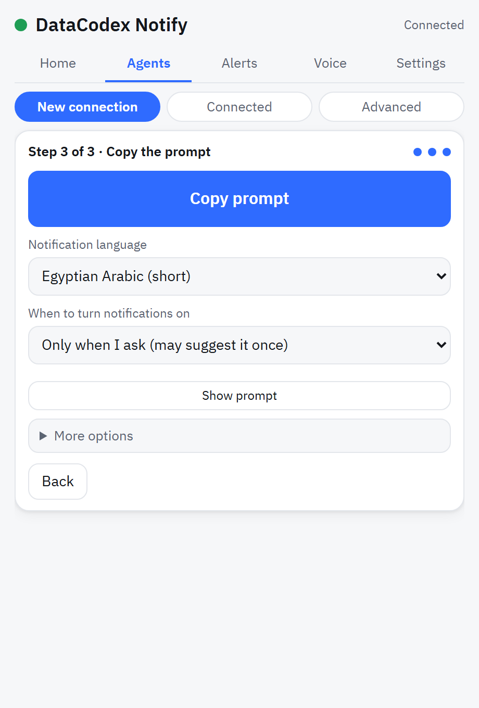
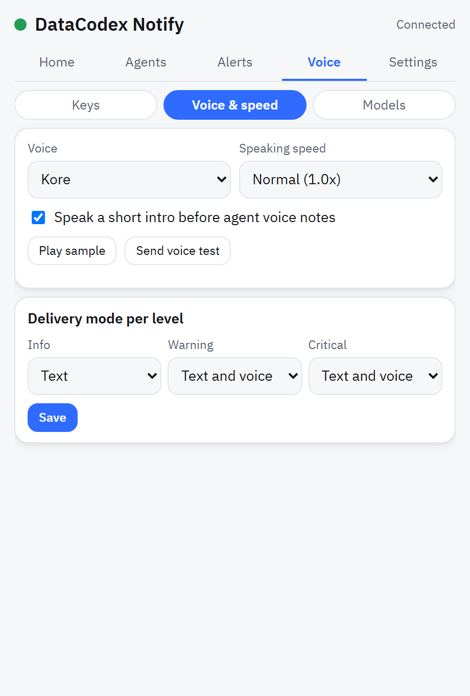
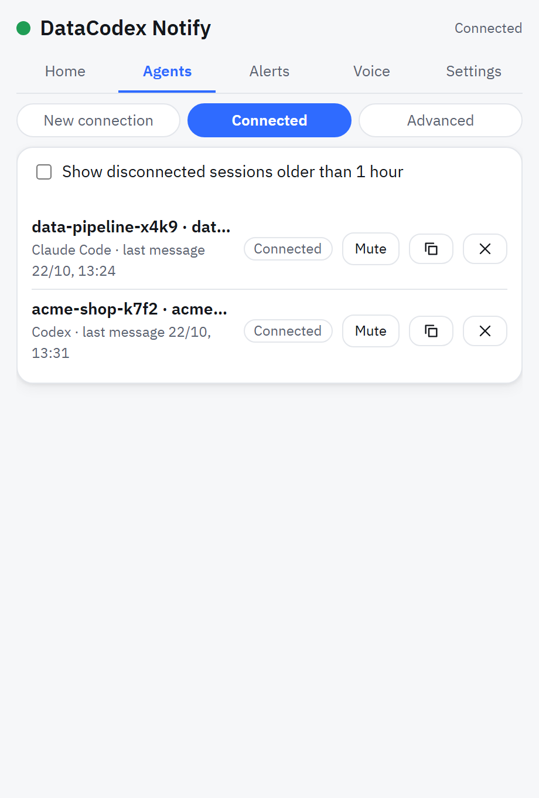
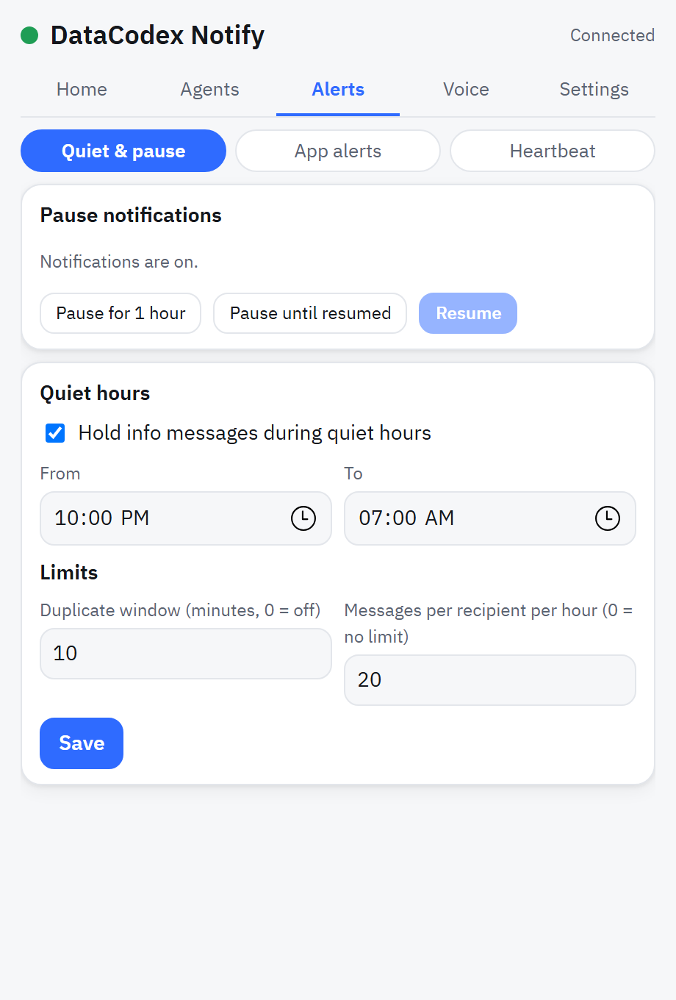
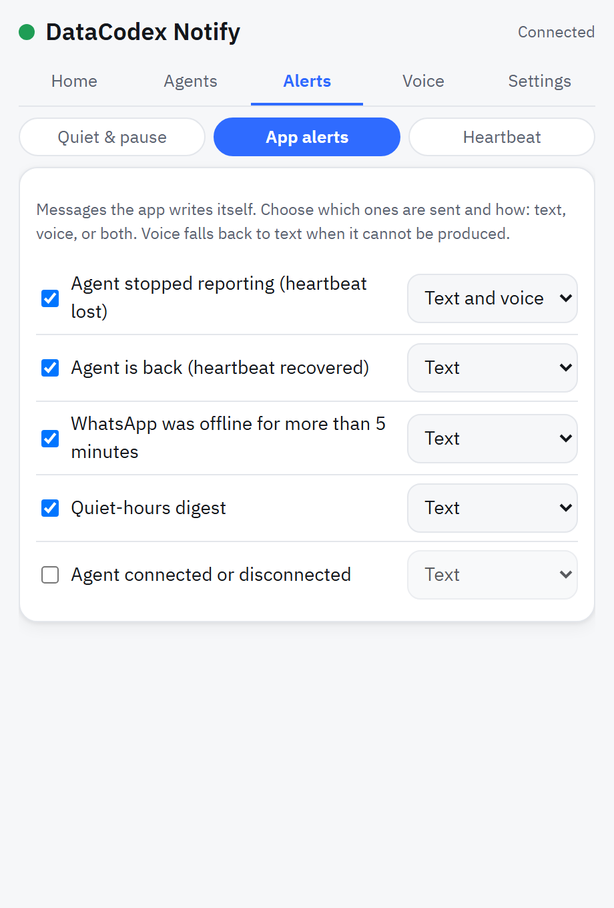
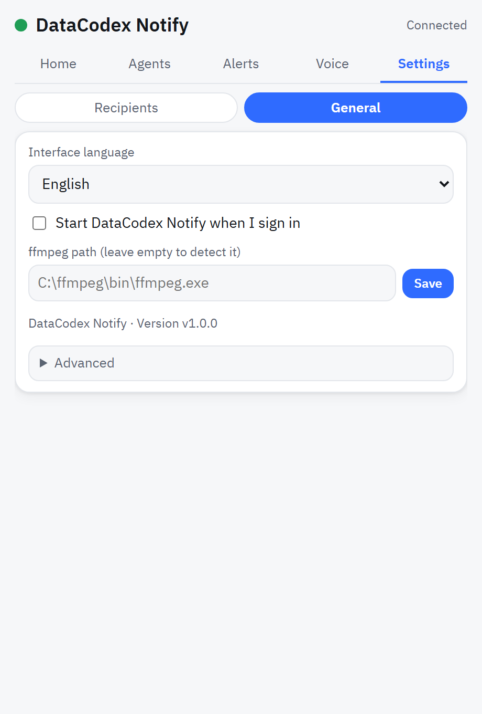
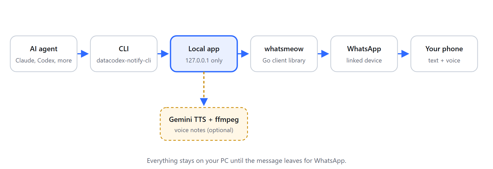

<div align="center">

# DataCodex Notify

**Your AI agent messages you on WhatsApp when it needs you.**
Text and voice notes from Claude Code, Codex, or Gemini, sent from a small Windows tray app that runs entirely on your PC.

[](LICENSE)
[](https://github.com/datacodexlab/datacodex-notify/releases)
[](https://github.com/datacodexlab/datacodex-notify/actions/workflows/ci.yml)
[](#requirements)

[Presentation](https://datacodexlab.github.io/datacodex-notify/) | [العربية](README.ar.md)

 &nbsp; 

</div>

---

## Why

Long agent runs do not fit in front of a screen. A build breaks at minute twelve, the agent waits for your approval for two hours, and you find out at dinner. DataCodex Notify turns those runs into a few short WhatsApp messages (and a voice note when it really matters), so you can walk away.

## Features

- **WhatsApp text and voice notes.** Send from any agent through one small command-line tool.
- **A clear message layout.** Agent and project in the header, an optional title, short key/value facts, and the time. Warning and critical messages stand out.
- **Voice notes with Gemini speech.** Your own Gemini key, selectable models with a fallback, normal / fast / very fast speed, and an optional spoken intro ("Message from Codex, project acme-shop."). If voice is not possible, the message is sent as text instead of being lost.
- **Connect an agent in three steps.** The app writes a prompt you paste into the agent; the agent adds its own instructions. A skill for Claude Code and Codex can be installed from the window.
- **Rules.** Quiet hours with one digest afterwards, pause for an hour, duplicate suppression, a per-hour limit, and per-agent or global mute.
- **Heartbeat (dead-man's switch).** If an agent stops reporting, you get a message instead of silence.
- **Per-alert control.** Every message the app writes itself (heartbeat lost, WhatsApp offline, digest, ...) has its own on/off switch and text/voice/both mode.
- **Local first.** The API listens on `127.0.0.1` only. Tokens live in Windows Credential Manager.
- **Arabic and English interface**, right-to-left aware.

## Screenshots

All screenshots use demo data and are generated from the code (see [Contributing](#contributing)).

| Link WhatsApp | Home | Connect an agent | Voice |
|---|---|---|---|
|  |  |  |  |

| Agents | Alerts | App alerts | Settings |
|---|---|---|---|
|  |  |  |  |

More images, including the Arabic interface, are in [`docs/assets/screenshots/`](docs/assets/screenshots).

## How it works



1. The agent runs `datacodex-notify-cli send ...`.
2. The CLI talks to the local app on `127.0.0.1` with a bearer token it reads from Windows Credential Manager.
3. The app applies your rules, lays out the message, and sends it through a linked-device session ([whatsmeow](https://github.com/tulir/whatsmeow)).
4. For voice, the app asks Gemini for speech and converts it with ffmpeg.

## Requirements

- Windows 10 or 11 (64-bit).
- Microsoft Edge (used for the settings window).
- A **secondary** phone number with WhatsApp to link (see the [disclaimer](#disclaimer)).
- Optional, for voice notes: [ffmpeg](https://ffmpeg.org/) and a Gemini API key.
- To build from source: Go 1.26 or newer. Release builds are pure Go (`CGO_ENABLED=0`).

## Install

**Installer (recommended).** Download `DatacodexNotify-Setup-<version>.exe` from the [Releases](https://github.com/datacodexlab/datacodex-notify/releases) page and run it. It installs for your user only (no administrator rights) into `%LOCALAPPDATA%\Programs\DatacodexNotify\`, adds a Start menu entry, and offers two optional checkboxes: *Start with Windows* and *Install the agent skill*. Installing a newer version over an old one keeps your data. The uninstaller stops the app and asks before it deletes your data (the WhatsApp link and the message log).

**Portable zip.** `DatacodexNotify-Portable-<version>.zip` holds the two programs without an installer; see `README-portable.txt` inside.

**Unsigned builds and SmartScreen.** The releases are not code-signed yet, so Windows SmartScreen may say "Windows protected your PC". Click **More info**, then **Run anyway**. Before you do, check the file against `SHA256SUMS` from the same release page:

```powershell
Get-FileHash .\DatacodexNotify-Setup-<version>.exe -Algorithm SHA256
```

To build the installer yourself you need [Inno Setup](https://jrsoftware.org/isinfo.php) (`winget install JRSoftware.InnoSetup`): run `./installer/build.ps1 -Version <version>`; the files appear in `dist/`.

**Command line only.** `datacodex-notify-cli skill install` installs the agent skill for Claude Code and Codex without the window (`skill remove` removes it).

From source:

```powershell
git clone https://github.com/datacodexlab/datacodex-notify.git
cd datacodex-notify
$env:CGO_ENABLED = "0"
go build -trimpath -ldflags "-s -w -H=windowsgui -X main.version=1.0.0" -o dist/datacodex-notify.exe ./cmd/datacodex-notify
go build -trimpath -ldflags "-s -w -X main.version=1.0.0" -o dist/datacodex-notify-cli.exe ./cmd/datacodex-notify-cli
```

The app listens on port `48700` (it falls back to `48701`-`48709` if that is busy) and keeps its data in `%LOCALAPPDATA%\DatacodexNotify\`.

## Link WhatsApp

1. Start the app and open the window from the tray icon.
2. On the secondary phone: WhatsApp, **Linked devices**, **Link a device**, and scan the code on the Home screen.
3. If the code expires, press **Show new code**.
4. Add the number that should receive messages (Settings, Recipients).

## Connect an agent

1. Open **Agents, New connection**.
2. Choose the agent and where to write its rules, choose how much it should report (calm, normal, detailed), and press **Copy prompt**.
3. Paste the prompt into the agent. It writes a short block into its own rules file. The prompt never contains a password or token.
4. Optional: **Agents, Advanced, Install or update** installs the skill for Claude Code and Codex.

Notifications stay off until you switch them on in the agent's conversation (for example "notify on"). A one-off request such as "send me a test message" sends a single message without registering a session.

## Command-line reference

```text
datacodex-notify-cli send --level info|warning|critical --text-file message.txt
    [--title TEXT] [--field key=value ...] [--project NAME] [--source claude-code|codex|gemini|other]
    [--session NAME] [--mode text|voice|both] [--speech-file speech.txt] [--to NAME|NUMBER]
    [--dedupe-key KEY] [--wait SECONDS]
datacodex-notify-cli connect --source ... --session NAME [--project NAME] [--rules-file PATH ...]
datacodex-notify-cli disconnect --session NAME
datacodex-notify-cli heartbeat --id ID [--every SECONDS --grace SECONDS --label TEXT --session NAME]
datacodex-notify-cli heartbeat-stop --id ID
datacodex-notify-cli status | open | version
```

Write non-ASCII text to a UTF-8 file and pass it with `--text-file`. Limits: title 120 characters, up to 8 fields (key 40, value 200 characters), speech 600 characters, `--wait` up to 60 seconds.

| Exit code | Meaning |
|---|---|
| 0 | Accepted (queued, sent, or held on purpose) |
| 1 | Server error, or the message failed while waiting |
| 2 | The app is not running |
| 3 | Authentication failed |
| 4 | Invalid request (bad option, empty text, limits exceeded) |
| 5 | Deduplicated or rate limited (not an error) |
| 6 | The user muted this session or all agents: stop sending |
| 7 | With `--wait`: still queued after the wait (not an error) |

## Privacy and security

- The HTTP API binds to `127.0.0.1` and rejects requests with a foreign `Host` or an `Origin` header.
- The agent API uses a bearer token; the window uses an HTTP-only session cookie plus a CSRF token. The token is generated on first start and stored in Windows Credential Manager. You can rotate it from **Agents, Advanced**.
- Gemini keys are stored in Credential Manager, shown masked, and never written to logs or to generated prompts.
- Message text is sent only to WhatsApp (and, for voice notes, the text to be spoken is sent to Google's Gemini API). Nothing else leaves your PC.
- Message history stays in a local SQLite file in `%LOCALAPPDATA%\DatacodexNotify\`.

## Disclaimer

DataCodex Notify is **not affiliated with, endorsed by, or connected to WhatsApp or Meta**. It uses the open-source [whatsmeow](https://github.com/tulir/whatsmeow) library, an **unofficial** client of the WhatsApp Web protocol. WhatsApp may restrict or ban accounts that use unofficial clients, and the protocol can change at any time. **Use a secondary number you can afford to lose**, keep volumes low, and use it at your own risk. "WhatsApp" is a trademark of its owner; it is named here only to describe compatibility.

## FAQ

**Does it work on macOS or Linux?** Not yet. The tray app, Credential Manager storage, and window launcher are Windows-specific.

**Do I need the voice features?** No. Without a Gemini key or ffmpeg everything is sent as text.

**Can several agents share it?** Yes. Each conversation registers its own session; you can see, mute, or remove them under **Agents, Connected**.

**What if WhatsApp says the app is outdated?** The window shows a banner and the tray icon turns red. Update the app (the WhatsApp library needs a newer version).

**Where is my data?** `%LOCALAPPDATA%\DatacodexNotify\` (settings, history, WhatsApp session). Uninstalling is deleting the program folder and that data folder.

## Contributing

Issues and pull requests are welcome. Please keep changes small and tested.

```powershell
go vet ./...
go test -short ./...                 # fast suite
go test -tags devfake ./...          # uses a fake WhatsApp sender, never the network
go test ./internal/ui                # also renders every tab in headless Edge (needs Node and Edge)
```

Regenerate the screenshots, chat mockups, and diagram after any UI or message-format change. The command renders the demo data set from the code at HEAD (it refuses to run when `web/` has uncommitted changes) and writes `docs/assets/BUILD-INFO.txt` with the commit it used:

```powershell
go run ./tools/docsgen
```

It needs Go, Node, and Microsoft Edge. No real data is ever read: the screenshots come from a stub API with a fake name, number, and projects.

## License

DataCodex Notify is free software: you can redistribute it and/or modify it under the terms of the **GNU General Public License, version 3 only** (SPDX: `GPL-3.0-only`). See [LICENSE](LICENSE).

Copyright (C) 2026 DataCodex

This program is distributed in the hope that it will be useful, but WITHOUT ANY WARRANTY; without even the implied warranty of MERCHANTABILITY or FITNESS FOR A PARTICULAR PURPOSE. See the GNU General Public License for more details.

Why GPL-3.0-only: the WhatsApp library stack the app is built on includes `go.mau.fi/libsignal`, which is licensed under GPL-3.0 (version 3, with no "or later" option), so the combined program is distributed under that license. Other dependencies and their licenses are listed in [THIRD_PARTY_NOTICES.md](THIRD_PARTY_NOTICES.md). Bundled font: IBM Plex Sans Arabic (SIL OFL, see `web/fonts/LICENSE-OFL.txt`).
